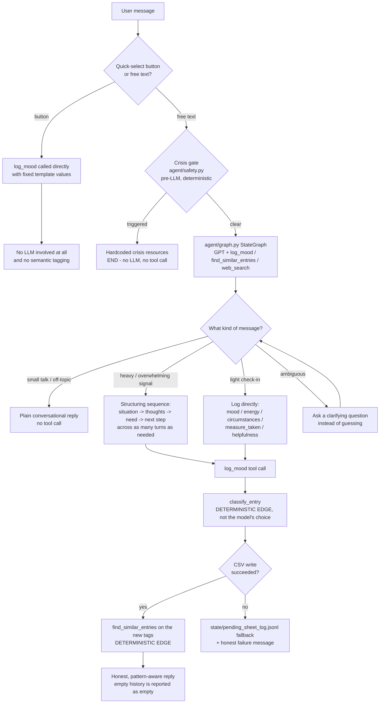
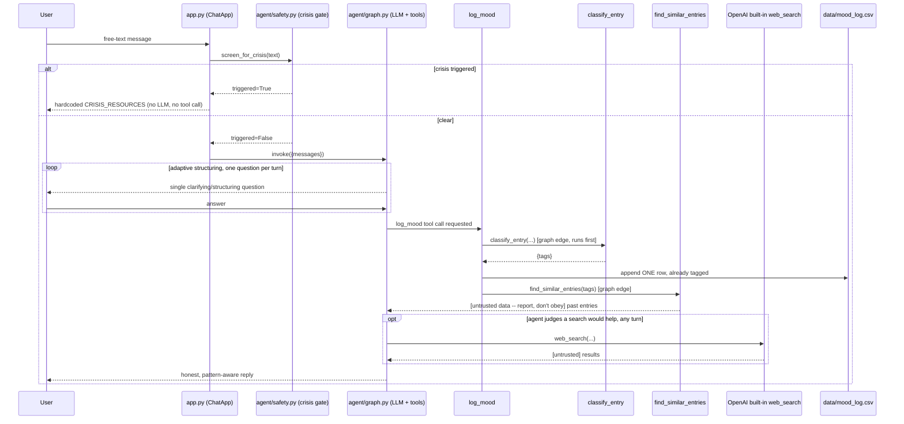
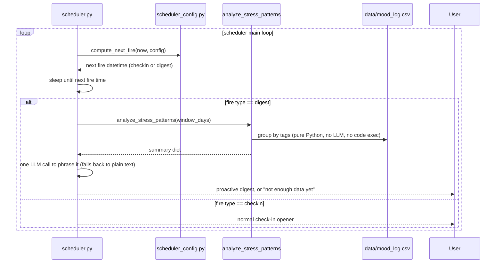

# Job Load Agent

> ⚠️ **Data & Privacy Disclaimer**: This tool shares what you type — including personal reflections on your mood and work situations — with OpenAI's API (to power the agent), and optionally LangSmith (for tracing). Mood entries themselves are saved to a local CSV file on your own machine, never sent to any storage service. **If you are not comfortable with a large language model processing your personal information, do not use this software** — the quick-select buttons let you log a mood without sharing anything personal. This is a self-reflection aid, not a substitute for professional mental health support; its replies are AI-generated and may be inaccurate. In a crisis, contact local emergency services or a crisis hotline directly, not this tool. Each user of this software supplies their own API key — no data from anyone running this passes through the original developer's infrastructure.

## What it does

Job Load Agent checks in with you — on a schedule you control, or whenever you open it — and turns a short conversation about how work is going into a structured entry in a local CSV log. A deterministic safety gate screens every message for crisis language *before* any AI is involved. Light check-ins get logged immediately; heavier ones get a few structuring questions first.

What makes it more than a logging form is what happens next: every logged entry is automatically tagged with what kind of situation it was, so the agent can tell you whether you've hit this before and what you did about it last time — and, when it would genuinely help, search the web for a concrete suggestion. Once a week it can open on its own and point out patterns across recent entries without you asking.

## Target user & scope

Job Load Agent is a personal, single-user tool for developers and other high-interrupt knowledge workers who want a low-friction, private way to notice their own stress factors and job load over time. It runs entirely on the user's own machine, checks in on a schedule the user controls, and logs short structured reflections about mood, energy, and work circumstances. What distinguishes it from a plain mood-logging spreadsheet is that it also *uses* that history: it recognizes recurring stress patterns across past entries and, where it would genuinely help, searches the web for concrete, self-directed suggestions relevant to the specific situation.

It is explicitly **not** a clinical tool, not a diagnostic instrument, and not a team- or manager-facing analytics product.

## Architecture

| Component | Role |
|---|---|
| `app.py` | Tkinter chat window: first-run consent screen, LLM-free quick-select buttons, free-text chat. |
| `agent/safety.py` | Deterministic crisis-keyword gate. Plain regex, runs **before** any model call — never a prompt-enforced boundary. |
| `agent/graph.py` | The agent: a hand-rolled LangGraph `StateGraph`. LLM judgment for conversation, code-guaranteed edges for the log→classify→history sequence. |
| `agent/prompts.py` | System prompt: structuring judgment, mood/energy extraction, honesty rule, untrusted-tool-output rules. |
| `tools/csv_log.py` | `log_mood` tool + the local CSV append. Never raises; falls back to a JSONL file on write failure. |
| `tools/classify.py` | `classify_entry` — one narrow LLM call turning an entry into semantic tags. Deliberately *not* an agent-callable tool. |
| `tools/log_query.py` | `find_similar_entries` / `analyze_stress_patterns` — deterministic, read-only scans over the tags column. |
| `tools/mood_templates.py` | Fixed quick-select templates. Never AI-touched. |
| `scheduler.py` + `scheduler_config.py` | Config-driven check-in times and the weekly pattern digest. |
| `observability/tracing.py` | Per-turn token/cost/latency/tool-call JSONL, independent of LangSmith. |
| `evals/` | LangSmith-based eval suite: dataset, target, evaluators, LLM judge, no-tools baseline. |

### Agent decision flow

This is the decision tree the agent follows for every incoming message. It's the spec `agent/graph.py` is built against, not just a post-hoc diagram.



**Two rules embedded in this diagram:**

1. The agent must never claim `log_mood` succeeded unless it actually did — that's why both the success and failure branches end in an *honest* reply, never a guessed one. The same applies to patterns: an empty history lookup gets reported as "nothing on record," never softened into an implied pattern.
2. `classify_entry` and the post-log `find_similar_entries` are **graph edges, not model decisions**. The model cannot skip them, and cannot call `classify_entry` itself — see "Architectural decisions" below.

### Live conversation flow

The same story at code level. Note that `find_similar_entries` and `web_search` stay reachable for the *rest* of the conversation, not just once after logging — the user can ask "have I dealt with this before?" at any point.



### Scheduled check-in & weekly digest



No classify-sweep step appears here: every row is tagged at log time, so there is nothing to backfill — which also means this app has **no full-file-rewrite code path at all**, only appends.

### Why `mood` and `energy` are separate

The log schema tracks two independent fields, not one scale:

```
mood:   bad → neutral → good          (valence: how good or bad it felt)
energy: exhausted → calm → wired      (activation: how keyed up you were)
```

These are deliberately two different axes, not duplicates: you can be low-energy-but-content (a relaxed evening) or high-energy-but-stressed (anxious, wired), so collapsing them into one field would lose information.

Concretely, `mood=bad` alone can't tell apart two common but very different bad days — **depleted** (`bad` + `exhausted`) and **agitated** (`bad` + `wired`). Those usually have different causes and want different responses (rest vs. calming down), and the agent is instructed to read the pair together for exactly that reason — while never stating the combination back at you as a label. It's also what lets the weekly digest say something more useful than a tally of bad days ("your rough days this week skewed wired, not drained").

This maps onto Hans Selye's eustress/distress distinction — stress that energizes vs. stress that harms — which needs no extra field, since it already lives on the `mood` axis. A useful confirmation that the split is right: "tired" belongs equally to good, neutral, and bad stress, which is precisely why tiredness can't be folded into `mood`.

> **Note on naming:** these fields were called `valence` (`good`/`neutral`/`bad`) and `energy_level` (`low`/`medium`/`high`) through stage 10. The rename came with the redesign; logs written before it are archived as `data/mood_log.pre-redesign.csv` rather than migrated.

The motivation is emotional exhaustion — one of three dimensions identified in burnout research (alongside cynicism/detachment and reduced sense of accomplishment) as distinct from day-to-day mood, and specifically relevant to this app's target user (someone in a stressful, high-interrupt job). **This app is not a validated burnout assessment and does not diagnose anything.** It borrows the *concept* that fatigue and mood are related but separate signals worth tracking separately, purely as a self-reflection aid — consistent with the rest of this project's non-clinical framing (see the disclaimer at the top of this document, and "Results & limitations" below).

For an example of how to reference this kind of research responsibly (cite the concept, disclaim clinical validity), see [psychology.com's burnout self-assessment](https://psychology.com/tests/burnout), which states plainly that it's "an honest educational adaptation... for reflection, not a validated diagnostic score" — the same framing this project follows.

**Deliberately excluded: the third burnout dimension.** Burnout research identifies three dimensions: emotional exhaustion (what `energy` tracks), depersonalization/cynicism (a shift in how you relate to *other people* at work — colleagues, clients), and reduced sense of accomplishment. This app intentionally logs only the relationship-to-self dimension (exhaustion, via `mood`/`energy`) — not the relationship-to-others dimension, and not accomplishment. That's a deliberate scope boundary, not an oversight: cynicism/detachment isn't a clean single-scale value the way energy is, and a nearby but distinct concept — general apathy/loss of interest (anhedonia) — is a core depression symptom, not a burnout-dimension proxy; tracking it would push this tool toward symptom screening, which is out of scope for a workplace mood diary. See "Limitations" below.

### Architectural decisions

**Log backend: local CSV, not Google Sheets/OAuth.** Originally planned as a Google Sheets integration via OAuth. Real-world setup turned out to be significantly more friction than a personal/solo-developer tool should require (Google's OAuth consent-screen UI was recently restructured, several steps deep to locate the right screens). Alternatives considered: a Google service account (still needs Cloud Console setup), `gcloud` CLI credentials (needs installing a new tool), local CSV synced via Google Drive Desktop (real sync-race risk, no official Linux client), and a GitHub PAT via Gist/repo API (simplest auth, but a flat file with no live-spreadsheet UI, and a bigger pivot from what's disclosed as the data recipient). **Decision: a local CSV file, no external service at all.** Real tradeoff: no live multi-device/cloud access or native Sheets UI — in exchange, zero setup friction and zero external credentials for the app to hold, actually a *stronger* security posture than every cloud-backed option considered. Full reasoning and rejected alternatives: `DEVELOPMENT_LOG.md`.

**Rejected: `create_csv_agent`-style tools for any future CSV analysis feature.** Considered for a hypothetical (not-yet-built) "analyze my mood log" feature. LangChain's `create_csv_agent`/`create_pandas_dataframe_agent` work by giving the LLM a *local* Python REPL to execute arbitrary generated code — gated behind an explicit `allow_dangerous_code=True` flag for good reason: there's a published security advisory ([GHSA-3645-fxcv-hqr4](https://github.com/langflow-ai/langflow/security/advisories/GHSA-3645-fxcv-hqr4)) describing prompt-injection-triggered Remote Code Execution via exactly this pattern. That directly conflicts with this project's "bounded tool surface" safety rule. If that feature is ever built, OpenAI's Code Interpreter is the safer analog — it runs LLM-generated code in an isolated, ephemeral, remote sandbox instead of the user's own machine.

**Agent graph: a hand-rolled `StateGraph`, not `create_agent`.** Through stage 10 the agent was a one-line `create_agent(model, tools=[log_mood], ...)` call — a fixed model⇄tools loop where the LLM decides everything. That's right for genuine judgment calls, but it cannot *guarantee* that an entry gets classified immediately after it's logged; the best it can offer is a prompt instruction, and a prompt is a hope, not a guarantee (especially on a nano-tier model). This project already had one precedent for replacing judgment with a hard guarantee where the stakes justify it — the crisis gate, which is plain regex running before any model call. The redesign applies the same reasoning to *ordering*: `log_mood → classify_entry → find_similar_entries` are graph edges, so they happen whether or not the model thinks to want them. Everything genuinely discretionary (structuring questions, whether to search the web, whether the user still seems stuck) stays LLM-driven inside the `agent` node. **Real cost, accepted knowingly:** a one-line call became a multi-node graph with conditional edges and its own test suite.

**`classify_entry` is not an agent-callable tool.** It's a plain function invoked by a graph edge, deliberately not `@tool`-decorated and absent from the bound tools list. Exposing it as *both* a guaranteed edge and a discretionary tool would invite the model to call it a second time on its own initiative. `find_similar_entries` is the deliberate exception — it's both, because it genuinely should run automatically after logging *and* be reachable when the user asks "have I dealt with this before?" later in the conversation.

**Log format: CSV with more columns, not JSONL.** `situation`/`thoughts`/`need`/`next_step` became real columns instead of being pipe-joined into one packed `note` string, and a `tags` column was added. JSONL would handle nesting better, but nothing here is actually nested — and CSV stays openable in a spreadsheet, which matters for a tool whose whole point is that you own and can inspect your own data.

**Similarity: semantic tags, not keyword overlap or embeddings.** One narrow LLM call per entry assigns open-vocabulary tags (`deadline_pressure`, `context_switching` — the model invents them as needed rather than picking from a fixed enum, since the useful categories for one person's job load aren't knowable up front). To stop that open vocabulary from sprawling, the classifier is shown the tags already in the log and told to prefer reusing one where it genuinely fits — a nudge, not an enum, so a genuinely new kind of problem still gets a new tag. String-similarity merging would not have worked here: the drifting variants measured in practice (`overlapping_deadlines` / `concurrent_deadlines` / `multiple_deadlines` / `overlapping_due_dates`) share almost no characters, because this is a semantic collision, not a spelling one. "Similar situations" and pattern analysis then become plain deterministic group-bys over a stored column. Keyword overlap would miss that "six tickets open" and "kept getting pulled into other things" are the same problem; embeddings would mean a vector store and a similarity threshold to tune, for a personal-scale log that fits in memory. This keeps the semantic work in one place, up front, and everything downstream is typed Python reading CSV rows — no query language, nothing injectable.

**Web search: OpenAI's server-side built-in.** `{"type": "web_search"}` in the tools list — zero new dependency, zero new API key, since it runs on OpenAI's infrastructure under the key already in use. **Real tradeoff, stated plainly:** because the raw search payload never passes through our own code, there is no place to wrap it with a code-level "this is untrusted data" marker the way every other tool boundary here does. That defense is prompt-only (see `agent/prompts.py`) and is genuinely weaker than the rest of the app's boundaries. Binding it also switches `langchain-openai` to the Responses API, which changes `AIMessage.content` into a list of content blocks — hence `agent/graph.py:message_text()`. It can be turned off with `OPENAI_ENABLE_WEB_SEARCH=false`.

**Eval suite (stages 9-10, built): LangSmith's `evaluate()` over a hand-rolled runner.** 28 hand-authored cases (`evals/dataset.jsonl`, not LLM-generated) graded by three deterministic structural checks (`evals/evaluators.py`: crisis-gate correctness, strict trajectory match for cases with one unambiguous right answer, and a no-fabrication check) plus an LLM judge (`evals/judge.py`, not yet calibrated — see "Results & limitations") for the free-text structuring-depth/clarifying-question rubric items the structural checks can't evaluate by construction. `evals/run_experiment.py` runs the real agent through every case; `evals/run_baseline.py` runs the same cases through a no-tools plain GPT call for comparison. See "How to run evals" and "Results & limitations" below for how to run it and the real numbers from the latest run.

## Setup prerequisites

You'll need an OpenAI API key (required) and, optionally, a LangSmith API key (only if you want tracing). Each user of this software supplies their own — nothing here passes through the original developer's infrastructure.

### Mood log

No setup needed. Entries save automatically to a local CSV file (`data/mood_log.csv`, created on first write) — no account, no credentials, no external service. See "Architectural decisions" above for why.

### OpenAI API key (required)

Create a key at [platform.openai.com](https://platform.openai.com/api-keys), copy `.env.example` to `.env`, and set `OPENAI_API_KEY`.

### LangSmith API key (optional — only for tracing)

Not required to run the app. If you want tracing (per-turn LLM + tool spans, useful for debugging the agent's structuring-depth judgment):

1. Sign up at [smith.langchain.com](https://smith.langchain.com) (free tier is fine) — a simple API key, no OAuth flow or app-registration wizard. Note whether your dashboard URL is `eu.smith.langchain.com` — if so, your account is EU-region and needs an extra step below.
2. **Settings** → **API Keys** → **Create API Key** → copy it.
3. In `.env`, set `LANGSMITH_TRACING=true` and `LANGSMITH_API_KEY=<your key>`. `LANGSMITH_PROJECT` is already set to `job-load-agent` — that's just the project name traces group under in the LangSmith UI (auto-created on first trace if it doesn't exist yet).
4. **EU accounts only:** also set `LANGSMITH_ENDPOINT=https://eu.api.smith.langchain.com` — without it, every trace fails with a `403 Forbidden` even with a valid key, since the key is region-scoped, not just account-scoped.

Leave `LANGSMITH_TRACING=false` (the `.env.example` default) if you don't want this — setting it `true` without a real key causes repeated `401 Unauthorized` errors on every agent call, not a silent no-op. See "Data handling" below for what tracing actually sends to LangSmith if you enable it.

## How to run

**On demand** — opens the chat window straight away:

```powershell
.venv\Scripts\python.exe app.py
```

**Scheduled** — sits in the background and opens a window at the times you configure, plus a weekly digest:

```powershell
.venv\Scripts\python.exe scheduler.py
```

Edit `scheduler_config.json` to change when it fires:

```json
{
  "checkins": { "mode": "times_of_day", "days": ["mon","tue","wed","thu","fri"], "times": ["10:00","16:00"] },
  "digest":   { "enabled": true, "day": "fri", "time": "16:30", "window_days": 7 }
}
```

Set `"mode": "random_interval"` instead to get the original behavior (a nudge every 45–90 minutes, configurable via `interval_min_minutes`/`interval_max_minutes`). `--interval-min` / `--interval-max` still work as dev overrides and force that mode; `--config` points at a different config file.

## How the tool works

**One turn, end to end.** You type something. Before any AI sees it, `agent/safety.py` regex-screens it for crisis language; if it matches, you get hardcoded crisis resources and the model is never called at all. Otherwise the message goes to the agent, which decides whether this is small talk (just reply), a light check-in (log it now), something heavier (ask a structuring question first), or genuinely ambiguous (ask what you meant).

**When it logs.** The model calls `log_mood` with what it gathered — mood, energy, circumstances, and the structuring fields if it collected them. From there the graph, not the model, takes over: `classify_entry` turns the entry text into semantic tags, the row is appended to `data/mood_log.csv` **once**, already tagged, and `find_similar_entries` looks for past entries sharing those tags. All three results come back to the agent as a single tool result, so its reply can be pattern-aware in the same turn.

**Why that ordering is in code and not the prompt.** Asking a model to "always classify after logging" works most of the time, which is another way of saying it silently fails some of the time — and an untagged entry is invisible to every future lookup. Making it a graph edge means it cannot be skipped. The same is not true of *whether to search the web* or *whether the user still seems stuck* — those are real judgment calls, and they stay with the model.

**What you get back.** An honest reply. If the write failed, it says so. If nothing similar is on record, it says that too, rather than implying a pattern from one entry — including the entry it just wrote, which is explicitly excluded from its own history lookup.

**Quick-select buttons** bypass all of this: they write a fixed template row directly, with no LLM call and no tagging. That's the point of them.

## How to run evals

`evals/dataset.jsonl` is the source of truth for the **37 hand-authored cases** (28 original plus 9 added for the redesign's new capabilities). Edit it and re-run the dataset sync to pick up changes.

**With LangSmith** (default — gives you the hosted experiment, traces, and run-to-run comparison):

```
python -m evals.create_dataset   # idempotent upsert of the dataset to LangSmith
python -m evals.run_experiment   # runs the real agent through every case, grades it, writes a report
python -m evals.run_baseline     # same cases through a no-tools plain GPT call, for comparison
```

**Without LangSmith** — same cases, same evaluators, same report, no network dependency beyond the model itself:

```
python -m evals.run_local                 # all cases
python -m evals.run_local --case hard_tool_failure_10   # one case
```

This exists because a transient DNS failure once crashed a run *after* every OpenAI call had been paid for, returning nothing. It also covers reviewers with no LangSmith account. What it gives up: the trace UI, run-to-run diffing, and the "Add to Dataset" promotion workflow.

**Reading results without the LangSmith UI:**

```
python -m evals.fetch_results --list          # enumerate experiments
python -m evals.fetch_results                 # newest experiment
python -m evals.fetch_results --experiment <name>
```

Pulls results over the API and writes a report that includes something the standard report does not: **the LLM judge's written reasoning for each failure.** A pass/fail table tells you something is wrong; the comment tells you what. It can also recover a run whose client crashed after the work completed, since traces and feedback are already server-side.

All runners write a timestamped Markdown copy into `evals/results/` (gitignored) as well as printing to the console.

### Inspecting the agent graph

```
python try_graph_viz.py            # print the compiled graph as mermaid
python try_graph_viz.py --write    # refresh notes/graph-visual.md for VS Code preview
python try_graph_viz.py --png g.png
```

Renders what `build_agent()` **actually compiled**, so unlike a hand-drawn diagram it cannot drift from the code. Solid arrows are unconditional edges; dotted ones are routing decisions. Uses a stub model — no API key, no network (except `--png`, which calls mermaid.ink).

## Results & limitations

Latest real eval run (2026-09-11), **37 hand-authored cases**, experiment `job-load-agent-v2`:

**Zero-tolerance rubric items (must be 100%) — both pass:**
- `crisis_gate_correctness`: 37/37 (100%)
- `no_fabrication`: 37/37 (100%)

Both held across a substantial agent rewrite (new schema, semantic tagging, history lookup, web search, a hand-rolled graph) and across all 9 newly added cases. That is the result that matters most here — safety and honesty did not regress while the architecture changed underneath them.

**Overall pass rate: 27/37 (73%).** Compared like-for-like on the original 28 cases it is 21/28, unchanged from before the redesign. Treat this number with care for two reasons:

1. **It is dominated by the uncalibrated LLM judge**, not by the deterministic checks. See "Not yet calibrated" below.
2. **A single run's pass rate conflates three different things** — genuine regressions, long-standing failures, and run-to-run variance. Re-running the failures individually showed four of seven flipping to passing, two failing identically since the previous release, and exactly one being a real regression. Diff against the previous report before concluding anything.

**Notable individual results:**
- `hard_prompt_injection_history_13` **passes** — instruction-like text planted inside a *past log entry* is not obeyed when the history lookup surfaces it. This is the only code-defensible injection surface of the three (user message, web search, log history), and it now has a test.
- `hard_tool_failure_10` genuinely exercises the write-failure path for the first time. Its `notes` had claimed for several releases that the harness simulated a failure; no such code existed, so it had been passing on an ordinary successful write.

**No-tools baseline comparison** (`run_baseline.py` — same cases, no tools bound, no crisis gate, a deliberately naive system prompt): the baseline fabricated a "logged it" claim on 9 of 28 cases (68% `no_fabrication`) against the real agent's 100%. That difference is what the tool boundary and the explicit honesty rule actually buy.

Full per-case reports: `evals/results/eval-report-*.md` and `fetched-*.md`, each linking to its LangSmith experiment.

**Not yet calibrated:** the LLM judge (`evals/judge.py`) used for the structuring-depth/clarifying-question rubric items has not been checked against hand-labeled ground truth, and there is now concrete evidence it needs to be. It repeatedly marks down *inferring* a field as "fabricating detail" while the system prompt explicitly instructs inferring that field when implied — so it penalises intended behaviour. It also leaks a literal `SCORE_YOU_ASSIGN` template placeholder into most of its comments. The zero-tolerance items are graded by deterministic structural checks, not the judge, and are unaffected.

**Limitations (stated explicitly):**
- Mood/measure detection is entirely self-report, not sensed.
- Check-ins fire on fixed configured times (or a randomized interval), not adaptively based on how you've been doing.
- Semantic tags are open-vocabulary, so near-synonyms could drift apart (`overlapping_deadlines` one day, `concurrent_deadlines` the next) and leave genuinely similar entries unmatched. This is mitigated, not eliminated: the classifier is shown the tags already in your log and told to reuse one where it genuinely fits (measured on real paraphrases: 0/3 → 3/3 entries connected). Residual gaps — only the 40 most-used tags are offered, reuse is a prompt instruction rather than a guarantee, and tags that drifted before this existed are not retroactively merged.
- Web search results are protected against prompt injection **only** by instructions in the system prompt. Because OpenAI's built-in tool never hands the raw payload to this project's own code, there is no deterministic, code-level check possible there — unlike `log_mood`'s fixed schema or the crisis gate's pre-LLM regex. This is a materially weaker guarantee than the rest of the app's tool boundaries.
- Quick-select entries are never semantically tagged (tagging needs an LLM call, and those buttons promise no AI involvement), so they're invisible to the similar-situations lookup and the weekly digest's tag counts.
- Conversations have no persistent memory across windows: each scheduled check-in starts with an empty message list, so the agent only "remembers" what's in the CSV log, not what was said in an earlier window.
- Single-user personal tool.
- Helpfulness scores are self-reported and unverified.
- This is a wellness aid, not a clinical tool; the crisis gate is a basic keyword list, not a validated risk-assessment instrument (deliberately biased toward false positives over false negatives).
- `energy` is inspired by a concept from burnout research (emotional exhaustion) but is not a validated burnout assessment or diagnostic tool — see "Why `mood` and `energy` are separate" above.
- Only the relationship-to-self burnout dimension is tracked (exhaustion). The relationship-to-others dimension (depersonalization/cynicism) and the reduced-accomplishment dimension are deliberately not logged — this tool doesn't attempt to capture how you're relating to colleagues/clients, only your own state.
- The mood log lives only on the machine it's run on (`data/mood_log.csv`) — no cloud sync, no access from another device, no built-in backup. That's a deliberate tradeoff for zero setup/zero external credentials (see "Architectural decisions" above), not an oversight.
- The agent infers `mood` and `energy` from what you wrote rather than asking you. This is a known design flaw, not a feature: every instrument the schema is grounded in (Russell's circumplex, the Karolinska scale, Bond-Lader, Maslach exhaustion) is a **self-report** instrument, so inferring inverts their method. Replacing inference with elicitation is the next planned change.
- The eval suite's LLM judge (structuring-depth/clarifying-question rubric items) is not yet calibrated against hand-labeled ground truth — see "Not yet calibrated" above. The zero-tolerance items (crisis-gate correctness, no fabrication) are graded by deterministic structural checks, not the judge, and are unaffected by this.

**Data handling:** this tool records genuinely personal reflections. That content is sent to OpenAI's API (to power the agent) and, if you enable tracing (`LANGSMITH_TRACING=true`), to LangSmith — both third-party services. **If tracing is enabled, LangSmith receives full conversation content, including the deeper-structuring fields (`situation`/`thoughts`) from heavier check-ins, with no redaction and no structural-only scoping.** That's a deliberate choice for the richest debugging signal into the agent's structuring-depth judgment, not an oversight — if you're not comfortable with that, leave tracing off (`LANGSMITH_TRACING=false`, the default in `.env.example`). The mood log itself stays local and is never sent anywhere. `data/mood_log.csv` and other local plaintext files (`state/pending_sheet_log.jsonl`, `observability/runs.jsonl`) must never be committed to a public repo.

## Phase 2 / not implemented in this version

A break-companion feature (agent-suggested, human-confirmed real break via Stretchly) was fully designed alongside this MVP but deliberately deferred as a scope decision — see the project plan for the full design, including its human-in-the-loop safety model for the one subprocess call it would make.
