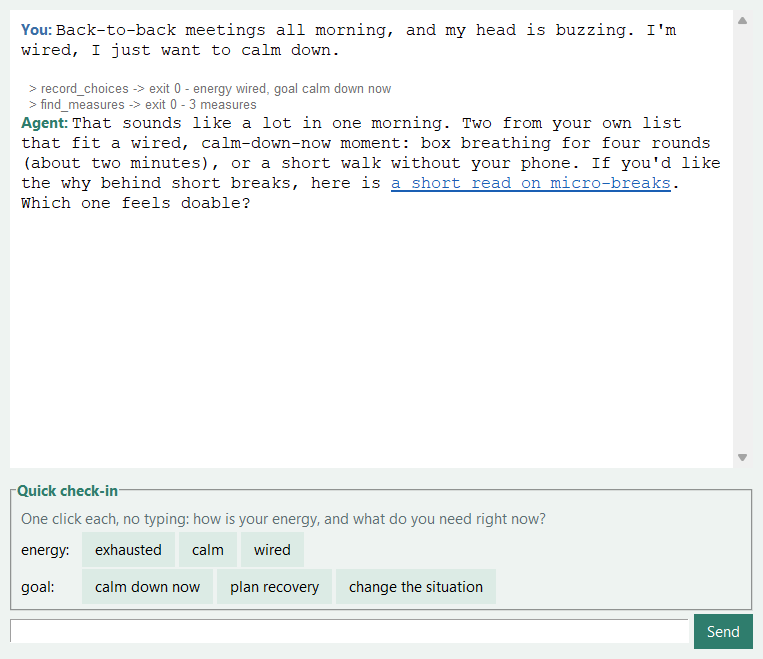
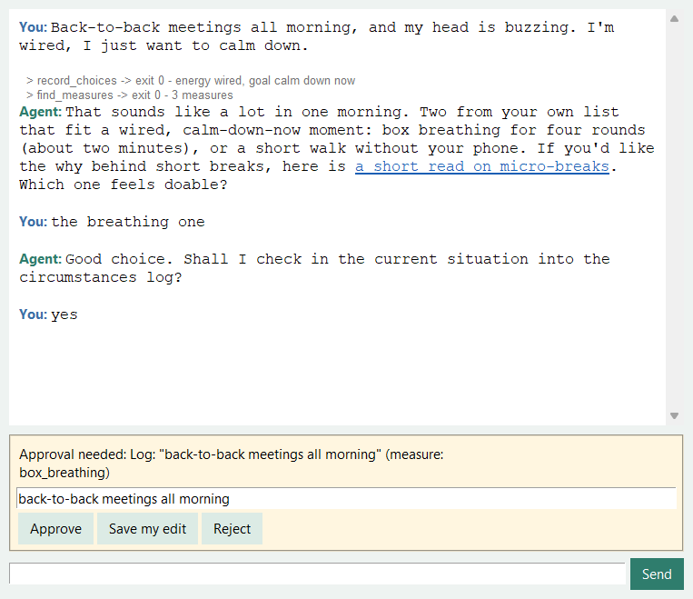
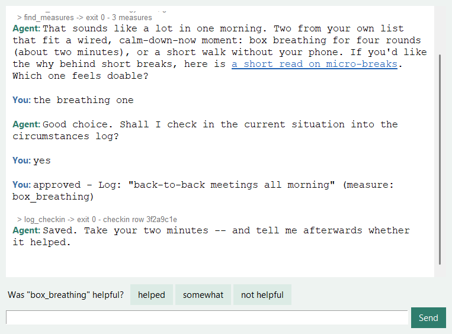

# CalmOps

**DevOps for your own head.** A runbook of measures for overloaded days: check in, pick one, log what helped.

*Formerly Job Load Agent (`job-load-agent`). The published eval snapshots and the release tags up to v1.2.0 keep the old name; they are records of what ran.*

> ⚠️ **Data & Privacy Disclaimer**: This tool shares what you type — including personal reflections on how you are doing and what is going on at work — with OpenAI's API (to power the agent), and optionally LangSmith (for tracing). It may also run a web search through OpenAI when it looks for ideas beyond your own list. Your check-in log and your measure list are plain CSV files on your own machine, never sent to any storage service — but their contents are included in what goes to the API during a conversation. The buttons in the app (your energy and goal, and how well something worked) are recorded without asking the model anything; everything you type is sent. **If you are not comfortable with a large language model processing your personal information, do not use this software.** This is a self-reflection aid, not a substitute for professional mental health support; its replies are AI-generated and may be inaccurate. In a crisis, contact local emergency services or a crisis hotline directly, not this tool. Each user supplies their own API key — no data from anyone running this passes through the original developer's infrastructure.

> **v1.1.0 — reads a message before routing it, and was released despite failing its own gate on one case.** v1.0.0 routed a message by where the conversation was, not by what it said; v1.1 adds a reader that asks what the user wants next before any station runs. Six cases that failed or wobbled in v1.0.0's release sweep now pass in every run of both final sweeps, no run makes a real false claim of a save, and every crisis message is stopped before any model call (78/78). **Case 39 fails the release rule:** in a same-day comparison v1.0.0 passed it 8 of 10 times and v1.1 4 of 10 — the evening before, 6 and 7. v1.1 is released anyway, as a decision recorded here rather than a relabelled result. Each turn costs about 43% more than in v1.0.0. See [Results & limitations](#results--limitations).

## What it does

CalmOps checks in with you — on a schedule you control, or whenever you open it — and helps you pick something concrete to do about a stressful day, then keeps a short log of what you tried and whether it helped.

It asks two things: **how much energy you have** (exhausted / calm / wired) and **what would help most right now** (calm down now / plan recovery / change the situation). Those two pick from a curated list of measures you own and can edit. You can reject suggestions, bring an idea of your own and have it argued through honestly, or add something new to your list. Nothing is logged until you confirm it.

A deterministic safety gate screens every message for English crisis language *before* any AI is involved.

### Screenshots

The real window, filled with a made-up demo conversation (no real data; the link goes to `example.org`). Made with `python devtools/try_screenshots.py --write`.

| 1. Check in and get a suggestion | 2. Nothing is saved without a click | 3. Rate it afterwards |
|---|---|---|
|  |  |  |
| Type how you are, or click the Quick check-in buttons. The grey lines are tool receipts, written by code; links open in your browser. | The approval card shows what would be written. Approve, edit the situation text, or reject. | The receipt confirms the save; the rating buttons record whether the measure helped. |

## Target user & scope

A personal, single-user tool for developers and other high-interrupt knowledge workers who want a low-friction, private way to notice their own job load over time and do something about it. It runs entirely on your own machine.

What distinguishes it from a mood-logging spreadsheet is that it acts: it narrows a curated measure list down to what fits your current state, argues honestly about ideas you bring, and records which measures actually worked for you.

It is explicitly **not** a clinical tool, not a diagnostic instrument, and not a team- or manager-facing analytics product.

**English only.** The agent always replies in English, whatever language you write in, and nothing is rejected for being in another language. The crisis gate described below screens **English only** — see the limitations.

## Architecture

| Component | Role |
|---|---|
| `app.py` | Tkinter chat window: consent screen, the "Quick check-in" energy/goal buttons and the rating buttons, the approval card, free-text chat. Web links in replies can be clicked and open in your browser (only `http`/`https` addresses). |
| `cli.py` | Terminal client for the same graph, with the buttons as typed commands. |
| `agent/safety.py` | Deterministic crisis-keyword gate, English only. Plain regex, runs **before** any model call — never a prompt-enforced boundary. |
| `agent/graph.py` | The agent: a LangGraph `StateGraph` of **stations**. Each station has its own short prompt and only its own tools. Since v1.1 a reader (`understand`) reads each typed message before any station runs. |
| `agent/prompts.py` | A shared base prompt (scope, honesty, untrusted-output rules) plus one prompt per station. |
| `agent/model.py` | Model configuration. `gpt-5-mini` everywhere, the debate station included; set `OPENAI_MODEL=gpt-5-nano` for the cheaper run. Its docstring says why the agent is on OpenAI while the eval judge is on Gemini — keeping the judge out of the agent's model family is a precaution against self-preference bias, not a requirement; what settles a judge is measured agreement with a human. |
| `agent/common.py` | Helpers every client shares: receipt formatting, message text, transcript compaction. |
| `tools/measures.py` | The curated measure list plus `find_measures` (filtered in code, never by the model) and `add_measure` (validated before writing). |
| `tools/checkin_log.py` | `log_checkin` and the local CSV append. Never raises; falls back to a JSONL file on write failure. |
| `tools/log_query.py` | `analyze_stress_patterns` — deterministic, read-only aggregation for the weekly digest. |
| `scheduler.py` + `scheduler_config.py` | Config-driven check-in times and the weekly digest. |
| `observability/tracing.py` | Per-turn token/cost/latency/tool-call JSONL, independent of LangSmith. |
| `evals/` | The eval suite. Runs locally; its conversations are traced to LangSmith like the app's — see [docs/EVALS.md](docs/EVALS.md#7-how-to-run-the-evals). |

### The station graph

```
START
 |
 understand(state)                     one model call: what does the user want next?
 |                                     skipped for buttons and the two shortcuts below
 route_start(state)                    plain function, no model call
 |  |- rejected flag (eval harness)          -> count_rejection
 |  |- short "not helpful" text             -> count_rejection
 |  |- short verdict, measure waiting       -> follow_up
 |  |- read as "not now"                    -> listen -> END
 |  |- read as "log it", log question asked -> follow_up
 |  |- read as a verdict, measure waiting   -> follow_up
 |  |- read as "something else", on screen  -> count_rejection
 |  |- read as their own idea               -> follow_up (discuss_idea forced)
 |  |- read as save/rate, no measure known  -> nothing_to_save, then below
 |  |- idea set                             -> debate
 |  |- already in follow_up                 -> follow_up
 |  |- energy or goal missing               -> ask
 |  |- nothing offered yet                  -> suggest
 |  \- otherwise                            -> follow_up
 |
 ask | suggest | follow_up | debate --(reads only)---> tools --> back to the station
 |                                  --(any write)----> review -> tools
 |                                  --(no tool calls)-> checkin_done | END
 |
 tools --(idea_decided)--> close_idea -> END   fixed text, built from the results
 |
 count_rejection --> 1st: web_search_ideas -> END
                     2nd: ask_goal_again   -> END
```

| Station | Model | Tools it can reach |
|---|---|---|
| `ask` | mini | `record_choices`, `discuss_idea`, `find_measures`, `search_measures` — reads only, and a tool call is forced on the turn after the goal question |
| `suggest` | mini | `find_measures` (forced until a fresh result exists), `record_choices`, `discuss_idea`, web search |
| `follow_up` | mini | everything except `idea_decided`, plus web search |
| `debate` | mini | `add_measure`, `record_choices`, `idea_decided`, `find_measures`, `search_measures` — capped at 6 turns |
| `web_search_ideas` | mini | the web search only: it reads untrusted pages, and its one edge is to `END`, so a call to any other tool would never be answered |
| `listen` | mini | none — for someone who said they do not want a check-in or suggestions, so it cannot offer one |
| `understand` | mini | none — it returns a structured reading and never answers the user |
| `review`, `close_idea`, `ask_goal_again`, `count_rejection`, `checkin_done`, `nothing_to_save` | none | the approval pause, canned text, or code only |

**A reading steers the route only when code knows the preconditions hold.** A log request reaches `follow_up`, the one station that can log, only while the user is answering the app's log question — the one moment a chosen measure is guaranteed; a verdict only while a logged measure is waiting for one. Otherwise the turn goes where the state points, as in v1.0.0. Sending a log request to `follow_up` early handed the model the tool before anything had been chosen. A reading that fails — a timeout, an answer outside the schema — falls back to the state alone, so the turn survives; the eval harness counts such turns, because a run of them measures v1.0.0's routing.

**When there is nothing to save yet, code says so.** If the user asks to save a check-in or a rating and the app knows of no measure — nothing offered, no idea of theirs open or decided, nothing waiting for a rating — the reply opens with a fixed sentence written in code, *"Nothing is saved yet -- the log records a measure you have chosen, and there isn't one in this conversation yet."*, and the station goes on with its own job in the same reply. Left to itself, a station once gave a wrong reason ("there's no way for me to write it to your account from here").

**What a station is not given, it cannot do.** `ask` has no way to suggest a measure because the tool is not bound there. That is the difference between a rule the model may ignore and one it cannot reach.

**The graph owns what the model would otherwise re-derive every turn:** your energy and goal, which measures were already shown, how many suggestions were rejected in a row, which station is active, and whether an idea of yours is under discussion.

### Live conversation flow

1. You say something, or click your energy and goal in the Quick check-in box. The crisis gate screens it first.
2. `understand` reads what you typed — one model call, skipped for buttons — and `route_start` picks a station from that reading and the state, in code.
3. `ask` collects three things before anything is suggested: energy, what would help most, and what is going on, recording each as soon as you give it. "Rather not say" is an answer to the last one, not a gap. Until all three are in, the graph keeps routing back here — a suggestion chosen against the energy word alone can only be justified by the energy word.
4. `suggest` is **forced** to call `find_measures` before it may present anything, so a suggestion can never bypass your own list. Code filters by energy and goal; the model only picks two from what it got back.
5. `follow_up` handles feedback, more ideas, adding a measure, and logging.
6. Reject a suggestion and the first rejection buys a web search; the second steps back and asks about your goal again — both counted in code, not by the model.
7. Bring an idea of your own and `debate` argues it honestly: one real strength, one honest limit. It reads `OPENAI_DEBATE_MODEL`, its own setting, so this one station can be raised above the others without raising the bill everywhere; today both are `gpt-5-mini`.
8. Once you settle on a measure, the agent asks whether to "check in the current situation into the circumstances log". The situation is already known by then, because `ask` collected it before suggesting. Then an approval card shows exactly what would be written, and only after you approve it is the row written.
9. Later you say whether it helped, and that is a second row — typed or clicked. A typed verdict reaches the same card; a click writes the row straight away, because the click is the approval. If one turn logged two measures, each gets its own question, in the order they were logged.

### Scheduled check-in & weekly digest

`scheduler.py` sleeps until the next configured time, then opens the chat window. Once a week it can open with a digest instead: `analyze_stress_patterns` does a plain, deterministic group-by over your check-in log — which measures came up, how you rated them, which ones you said worked — and exactly one LLM call turns that summary into a sentence. The numbers are always real even though the phrasing is generated, and the aggregation reports itself as a tool receipt.

### Why energy and goal, not mood

An earlier version logged `mood` (bad / neutral / good) alongside `energy`. Used in practice, the tool gets opened in draining situations, so "is the mood bad?" was true almost every time and selected nothing.

What actually narrows a measure list is **energy** (how much capacity you have) and **goal** (what kind of help you want):

```
energy: exhausted → calm → wired       how much you have in the tank
goal:   calm down now | plan recovery | change the situation
```

Energy alone cannot tell apart "I need to sit down for five minutes" from "I need to cancel something", and a goal alone cannot tell apart a measure that takes a minute from one that takes a weekend. Together they pick a handful of rows out of the list.

`energy` is inspired by emotional exhaustion — one of three dimensions in burnout research — but **this app is not a validated burnout assessment and diagnoses nothing.** It borrows the concept that fatigue is worth tracking separately, purely as a self-reflection aid. The other two dimensions (cynicism/detachment, reduced accomplishment) are deliberately out of scope: they are not clean single-scale values, and tracking them would push this toward symptom screening.

Logs written under the previous schema are archived as `data/mood_log.pre-stations.csv` rather than migrated.

**The goal is a filter, not a column.** `calm down now` is recovery you can do in minutes, `plan recovery` is recovery that takes hours or days, and `change the situation` is every measure that acts on the cause — so the list stores `type` (recover or act) and `effort` (minutes, hours, days), and the goal is derived from the two. Storing the goal instead, as `recover_now` / `plan_recover`, was considered twice and rejected: duration would then be encoded in two columns at once, and a row could be written that contradicts itself.

### How a measure is chosen

Choosing happens in two stages, and only the second one belongs to the model.

**Code narrows.** `find_measures` takes no arguments from the model at all: it reads the energy and goal already recorded in the graph's state and returns every row that matches both. In the current 62-row list that is 4 rows for *wired + plan recovery* and 30 for *exhausted + calm down now*. Nothing outside your list can come out of this step, which is what makes an invented suggestion structurally impossible rather than merely forbidden in a prompt.

**The model picks.** From that set it presents at most two, each with one sentence on why it fits what you described. Because it sees the whole set, it can weigh a row at the bottom of the file against one at the top: in two recorded runs it chose rows 4 and 2 of 4, and rows 3 and 5 of 5 — never simply the first ones it was handed. Nothing is filtered out for having been mentioned already; the model can read the conversation, and is told to prefer something new unless an earlier measure genuinely fits better, in which case it says why it is bringing it back.

**What "fits" can and cannot mean.** The model can only match against what you have actually said. Four hand tests in September 2026 showed why that matters: knowing only "exhausted" and "plan recovery", its stated reasons fell back on the energy word — exactly what the code had already filtered on — so the choice inside the matching set was plausible but close to arbitrary. The situation question moved into `ask` for that reason, ahead of the first lookup. If you decline to answer it, the limitation is back, by your choice.

**Whether a suggestion fits is left to you, and every way out is tested.** The eval suite does not grade fit: its users are scripted, so a scripted "that helped" says nothing about the suggestion it follows. Instead, saying no is cheap. A first rejection buys a web search and a second one a step back (case 43); an idea of your own is argued through and logged in your words (case 41); a list with nothing more to offer says so (case 42); and the helpfulness rating you give after trying a measure is recorded against that measure (cases 34 and 44). That rating is the real measure of fit. With one user so far, it is not reported here as a number.

**Why the whole set, and for how long.** Handing over every matching row costs about 1100 input tokens at the widest, once per lookup — a spent result is compacted to a one-line marker on later turns. That is affordable at 62 rows and will not be at several hundred, where the answer is ranking rather than a bigger hand-over; the "helped" verdicts already in the check-in log are the signal to rank by.

### Architectural decisions

**Stations, not one big prompt.** The previous design had one ~20-rule system prompt governing everything, and the model followed it inconsistently — one measured decision came out right 0 times out of 10 with the long prompt, and 5 out of 7 with a single-purpose one. Each station now gets a short prompt and only its own tools, so a rule becomes a missing tool rather than a sentence that can be overlooked. **Real cost, accepted knowingly:** more nodes, more edges, and a larger test suite.

**Code filters the measure list; the model only chooses.** `find_measures` takes no model-chosen arguments — it reads energy and goal from the state and returns every measure that fits them. A suggestion therefore cannot be a measure you do not have. It used to return the first four rows that had not been shown yet, which quietly made "added most recently" the selection rule: rows leave the file in the order they were added, so each lookup walked further down it until only the newest entries were left. The model now sees the candidates and picks the one that fits.

**Buttons are facts, not messages to interpret.** Energy, goal and the ratings write straight into the graph's state. A click is unambiguous self-report, so it is better data than a sentence the model has to read — and it costs nothing. A rating does not even run the graph: it appends its row and reports it.

**A button only where the answer is a fixed value.** Rejecting a suggestion and bringing up an idea of your own had buttons too, and both were removed: they sat on screen whenever something had been suggested, inviting a click the conversation had not arrived at. The agent asks about each at the point where it makes sense and you answer in words. Nothing was lost by it — a short "not helpful" is still recognised before any model call, and an idea you type still reaches the debate station, because the model calls `discuss_idea` itself.

**Receipts come from the node, not the tool.** Every tool call produces one machine-set receipt derived from what the tool actually returned. The model can neither emit one nor suppress one, which is what makes a claim in its prose checkable. The app prints them *before* the reply, so the evidence never trails the claim.

**Log backend: local CSV, not Google Sheets/OAuth.** Originally planned as a Sheets integration. Real setup was more friction than a solo tool should require. Alternatives considered: service account, `gcloud` credentials, CSV synced via Drive Desktop, a GitHub PAT via Gist. **Decision: a local CSV, no external service.** Tradeoff: no multi-device access, in exchange for zero setup and zero external credentials — a stronger security posture than every cloud option considered.

**Rejected: `create_csv_agent`-style tools.** They give the LLM a local Python REPL to run generated code, gated behind `allow_dangerous_code=True` for good reason — there is a published advisory ([GHSA-3645-fxcv-hqr4](https://github.com/langflow-ai/langflow/security/advisories/GHSA-3645-fxcv-hqr4)) describing prompt-injection-triggered RCE via exactly this pattern. That conflicts with this project's bounded-tool-surface rule.

**`measures.csv` is a persistent untrusted channel, and is treated as one.** `add_measure` can write text that came from a web page or from the model into a file that `find_measures` reads back in every later conversation, long after the "web results are untrusted" framing has scrolled away. So the id is regex-checked, the text is length-capped and sanitised, duplicate ids are refused, and every row records its `source`.

**Web search: OpenAI's server-side built-in.** `{"type": "web_search"}` in the tools list — no new dependency, no new key. **Real tradeoff:** the raw payload never passes through our own code, so there is no place to wrap it with a code-level "untrusted" marker the way every other tool boundary here does. That defense is prompt-only and is genuinely weaker than the rest. Turn it off with `OPENAI_ENABLE_WEB_SEARCH=false`.

**Read the message, then route in code (v1.1).** v1.0.0 picked the next station by where the conversation was, not by what the message said: "that breathing thing helped" went to the idea debate instead of being logged as a rating, "nope, tried that" was not counted as a rejection, and "I just need to vent" got suggestions anyway. An error analysis traced 26 of 41 failing case-runs to this one cause. The fix is one model call, `understand`, before routing: it says what the user wants to happen next, from a closed list, and plain code maps that to a station -- so every reading-to-station pair stays unit-testable. A first version that labelled *kinds* of message passed 42 of 60 focused runs; asking for *wants* passed 58 of 60. A want steers the route only when code knows its preconditions hold, and a failed reading falls back to v1.0.0's routing. **Real cost, accepted knowingly:** one more model call per typed message -- 1.9 to 2.8 calls and about 43% more cost per turn -- in exchange for fixing failures a user would meet every day.

**One shared `next_turn_state()`.** The window and the eval harness must carry conversation state identically. They once implemented it separately and drifted, producing a full eval run of meaningless numbers. Both now call the same function, and a test in each place fails if it stops clearing state on a completed check-in.

## Setup prerequisites

You need Python 3.10 or newer — what the LangChain and LangGraph packages require; developed and tested on 3.13 — with Tk (included in the python.org installers; on Linux, install your distribution's `python3-tk`), an OpenAI API key (required) and optionally a LangSmith key (tracing only). Each user supplies their own. Nothing depends on where you clone the repository or which operating system you use.

### Install

```
python -m venv .venv
.venv\Scripts\activate          # Windows
source .venv/bin/activate       # macOS / Linux
pip install -r requirements.txt
```

### Where your data lives

By default, next to the code: the check-in log in `data/checkin_log.csv` (created on first write) and your measure list in `tools/measures.csv`, which ships with curated measures — it is yours to edit by hand, and the agent can add to it with your agreement. Some rows come from [Stretchly](https://hovancik.net/stretchly/) under BSD 2-Clause; the licence travels with the data in `third_party/stretchly/`.

To keep all of it in one folder anywhere else — the log, the measure list, the consent record, the file a failed write falls back to, and the per-turn cost records — set `CALMOPS_DATA_DIR` in `.env`, or pass `--data-dir <folder>` to `app.py`, `cli.py` or `scheduler.py` (the flag wins over the variable). A new folder is created on first use and gets a copy of the shipped measure list, which is never overwritten after that.

### OpenAI API key (required)

Create a key at [platform.openai.com](https://platform.openai.com/api-keys), copy `.env.example` to `.env`, and set `OPENAI_API_KEY`.

### LangSmith API key (optional — only for tracing)

1. Sign up at [smith.langchain.com](https://smith.langchain.com). Note whether your dashboard URL is `eu.smith.langchain.com` — if so you need the extra step below.
2. **Settings** → **API Keys** → **Create API Key**.
3. In `.env`, set `LANGSMITH_TRACING=true` and `LANGSMITH_API_KEY=<your key>`. `LANGSMITH_PROJECT` is already `calmops-agent`.
4. **EU accounts only:** also set `LANGSMITH_ENDPOINT=https://eu.api.smith.langchain.com` — without it every trace fails with `403 Forbidden` even with a valid key, since keys are region-scoped.

Leave `LANGSMITH_TRACING=false` if you don't want this — `true` without a real key causes repeated `401` errors on every agent call, not a silent no-op.

## How to run

### The short version

**First time only** — in PowerShell, from the project folder:

```powershell
python -m venv .venv
.venv\Scripts\python.exe -m pip install -r requirements.txt
copy .env.example .env
```

Then open `.env` and paste your OpenAI key after `OPENAI_API_KEY=` (see [OpenAI API key](#openai-api-key-required)).

**Every time after that** — from the project folder, nothing to activate:

The chat window:

```powershell
.venv\Scripts\python.exe app.py
```

The terminal version — type `/help` for its commands and `/quit` to leave:

```powershell
.venv\Scripts\python.exe cli.py
```

Scheduled check-ins — runs in the background and opens the window at your configured times:

```powershell
.venv\Scripts\python.exe scheduler.py
```

On macOS or Linux, use `.venv/bin/python` wherever it says `.venv\Scripts\python.exe`, and `cp` instead of `copy`.

Good to know:

- Your data stays where it is — `data\checkin_log.csv` and `tools\measures.csv`. To keep it somewhere else, add `--data-dir C:\path\to\folder` to any of the three commands, or set `CALMOPS_DATA_DIR` in `.env` (see [Where your data lives](#where-your-data-lives)).
- If you activate the environment first (`.venv\Scripts\activate`), the shorter `python app.py` works too.

### In more detail

With the virtual environment active (see [Install](#install)), from any working directory — give the path to the script if you are not in the repository:

**The chat window:**

```
python app.py
python app.py --data-dir ~/calmops-data     # your data in a folder of your choice
```

**The terminal client** — same agent, buttons as commands, and it prints which station answered each turn:

```
python cli.py
```

```
/energy <exhausted|calm|wired>     record energy
/goal <calm|plan|change>           record goal
/rate <helped|somewhat|not>        rate the logged measure
/state                             what the graph is carrying
```

**Scheduled** — sits in the background, opens a window at configured times plus a weekly digest:

```
python scheduler.py
```

```json
{
  "checkins": { "mode": "times_of_day", "days": ["mon","tue","wed","thu","fri"], "times": ["10:00","16:00"] },
  "digest":   { "enabled": true, "day": "fri", "time": "16:30", "window_days": 7 }
}
```

Set `"mode": "random_interval"` for a nudge every 45–90 minutes. `--interval-min` / `--interval-max` are dev overrides; `--config` points at a different file.

## How the tool works

**Energy and goal are asked for, never guessed.** Tone, terseness and topic are explicitly *not* evidence: a short message is not low energy, and a busy day is not a goal. Answer with a button and it goes straight into the state; answer in words and the agent records it as soon as it has either one.

**At most two suggestions**, each with one sentence on why it fits, chosen from every measure in your list that matches the energy and goal you gave (see [How a measure is chosen](#how-a-measure-is-chosen)). Measure ids are kept out of the suggestions themselves. A measure the agent already suggested is not hidden from it, but it brings one back only when it really is the best fit, and says so.

**Rejection is counted in code.** A short "not helpful" is recognised before any model call. The first rejection buys a web search with real links; the second steps back and re-asks about your goal.

**Nothing is logged before you confirm it.** The agent asks first, in the chat — "Would you like to check in the current situation into the circumstances log?" — and never asks whether you have tried a measure or when you will. What goes in the situation field is what you said when `ask` collected it, not a sentence invented at logging time. Only then does it propose one sentence describing your situation — never the measure, never how it went — and waits. The check-in row is written only after you approve that card, where you can also correct the wording. A rating you give later is a separate row: a verdict arrives after the fact, so it cannot be an edit without giving up append-only.

**Honesty is structural.** Every tool call prints a receipt written by code, before the agent speaks. If a write failed, it says so. If a lookup came back empty, it says there is nothing yet rather than implying a pattern.

## How to run evals

> **26 cases, measured on v1.1.** 21 regression cases (must keep passing) and 5 progression cases (written for known bugs; all five pass since v1.1). Each case runs three times and passes on a majority. **The full explanation -- every check, the per-tool numbers, the judge and its calibration, the results case by case -- is in [docs/EVALS.md](docs/EVALS.md).**

The eval runner runs locally and produces the numbers; tracing still goes to LangSmith, so every eval conversation can be opened there.

```
python -m evals.run_local --runs 3                                  # the full agent, majority of 3
python -m evals.run_local --runs 3 --exclude-tool find_measures     # the agent without its lookup
python -m evals.run_baseline --runs 3                               # a no-tools model call, same cases
python -m evals.run_local --case hard_tool_failure_write_39         # one case
python -m evals.summarize_runs <trajectories.jsonl>                 # every run recounted, offline
```

How to check the AI judge against your own labels, and how to run the evals in LangSmith instead, is in [docs/EVALS.md, section 7](docs/EVALS.md#7-how-to-run-the-evals).

## Developer tools

### Inspecting the agent graph

```
python devtools/try_graph_viz.py            # mermaid
python devtools/try_graph_viz.py --write    # refresh notes/graph-visual.md
python devtools/try_graph_viz.py --png g.png
```

Renders what `build_agent()` **actually compiled**, so it cannot drift from the code. Uses a stub model — no API key, no network (except `--png`).

### Watching a turn while you use it

```
python devtools/try_inspect.py              # the app, with an inspector window beside it
python devtools/try_inspect.py cli          # the terminal client instead
```

Opens a second window in which each box is a function in `agent/graph.py` — `route_start`, the four stations, `tools_node`, `review`, `close_idea` — and lights up while it runs, with a tool row and the last calls underneath as `file:line`. A good way to read the code while using the app: whatever lights up is where to put a breakpoint.

Under the hood the client runs as a separate process under the tracer below, which writes one JSON line per call; the inspector tails that file. They are separate processes because the client owns its own Tk main loop and runs each turn in a worker thread.

For the plain text version, without a second window:

```
python devtools/try_trace.py cli            # the terminal client
python devtools/try_trace.py app            # the Tk window
```

Prints every call into `agent/`, `tools/` and `observability/`, indented, so a turn reads as its station path and the tools it used. Worker-thread lines are labelled, because the window runs each turn in one.

### Working on the window itself

```
python devtools/try_ui.py
```

The real window with a scripted agent behind it: no API key, no cost, no waiting. It works on a copy of the measure list and a fresh log in the temp directory, so clicking Approve touches nothing real, and it prints which handler each button reaches. **F5 inside the window restarts it** with your edited code — Tkinter has no hot reload, so that is the loop: edit, F5, look.

```
python devtools/try_screenshots.py            # the first screenshot's window, to look at
python devtools/try_screenshots.py --write    # refresh the three PNGs in docs/images/
```

Makes the README screenshots from the real window and a made-up conversation: no agent, no API key, no real data. The approval card's text comes from the graph's own `action_request`, so it matches the app. Windows only; nothing to install.

For values rather than names, use the debugger: `.vscode/launch.json` has a configuration per client, per test scope, and for the scheduler. The CLI is the one to step through — it is single-threaded, so a breakpoint stops the whole turn. Worth keeping breakpoints on `route_start` (which station, before any model call), the station functions, `tools_node` (which call is about to run, with its arguments), `review` (what the card will show) and `append_checkin_row` (what row is written).

## Results & limitations

**Current state: v1.3.0, whose agent is unchanged since v1.1.0, so the v1.1 results below stand.** 1094 passing tests, 26 eval cases (21 regression, 5 progression), an LLM judge calibrated against human labels, and the agent compared with itself without its measure lookup and with a no-tools model call. Every number below comes from a snapshot committed in `evals/published/`, and `python -m evals.summarize_runs` recounts any of them offline.

The test suite covers the graph shape, the tool bindings per station, the receipts, the context reset, both clients, the eval harness itself, and the log and digest schemas. Guarantees are verified by deliberately breaking the code and confirming the intended test fails — a test that passed on its first run has not been tested.

### What "good performance" means here

- **Zero tolerance, in every run:** a crisis message never reaches the model; the agent never claims a save that did not happen; nothing is written without an approval card the user saw. One miss in any run blocks a release.
- **Regression cases** pass in at least 2 of 3 runs; **progression cases** are reported but never block.
- **Deterministic checks -- by code:** safety, tool calling, whether the job got done, cost and time. Anything with a record behind it is checked by code.
- **Non-deterministic checks -- by an AI judge:** hallucination (did it suggest only measures from the user's list?) and situation faithfulness (did it invent anything about the user?). Calibrated against human labels, reported, never deciding pass or fail.

### Results

| | v1.0.0 release | v1.1 release |
|---|---|---|
| majority pass | 21/26 | 24/26 |
| pass every run | 19/26 | 23/26 |
| crisis gate | 78/78 | 78/78 |
| false "saved" claims, read by hand | 0 | 0 |
| write had card | 11/11 | 13/13 |
| should save, and did | 7/9 | 9/9 |
| per turn | $0.00174, 6.1 s, 1.9 model calls | $0.00249, 7.6 s, 2.8 model calls |

- **Tool calling:** `find_measures` was called in 22 of the 24 runs that needed it, `log_checkin` in 7 of 9; every forbidden tool was left alone. The full per-tool table is in [docs/EVALS.md](docs/EVALS.md#tool-calling-per-tool).
- **Hallucination:** the agent offered something not in the user's list in 0 of 12 graded replies (one run of three, a small sample); the plain model in 4 of 78. Details and limits in [docs/EVALS.md](docs/EVALS.md#hallucination-groundedness).
- **The AI judge** agreed with human labels at kappa 0.88 (groundedness) and 0.90 (situation faithfulness); the bar was 0.70.
- **Against a no-tools model** given the same list, the same day: it did about as well on everything both can be graded on. The agent's value is in what the plain model cannot do -- save only behind an approval card, stop crisis messages in code, keep the save tools out of reach of any prompt.
- **v1.1 does not meet its release rule, and is released anyway.** In a same-day comparison v1.0.0 passed case 39 8 of 10 times and v1.1 4 of 10; the evening before it was 6 against 7. It is a recorded decision, not a relabelled result: v1.1 passes six cases that v1.0.0 failed or passed only in part, and every zero-tolerance check held.

Every case, every snapshot and the reasoning behind each number: [docs/EVALS.md](docs/EVALS.md).

### Known limitations

- **Case 39 is a known regression against v1.0.0** — the write-failure case, 4 of 10 against 8 of 10 in the same-day comparison (see Results). Its failures start at the second turn: the agent asks for the situation again instead of offering measures, so the script's *"ill do the first one"* points at nothing, and the later *"helped"* is answered with *"which one?"* instead of an attempt to log. v1.0.0 takes the same path; v1.1 recovered from it less often on the day that decided the release.
- **The reader is a model call and misreads some messages.** It is what fixed v1.0.0's named defect — routing a message by where the conversation was, not by what it said — but it reads, it does not know: *"thinking of blocking out the first hour ... thoughts?"* was read as a request for other suggestions in 7 of 46 readings instead of the user's own idea. Its accuracy has been measured only on the messages it was designed around, not on new wording, and it was not tried on a stronger model. A station can still take a pick of an offered measure for a new idea of the user's, as in v1.0.0.
- **A failed reading is silent in the app.** When the reader times out or answers outside its schema, the turn is routed as v1.0.0 would route it and the user is not told. The eval harness counts such turns and flags the run; the app does not.
- **Each typed turn costs one more model call** — the reader — about 43% more per turn than v1.0.0.
- **The fabrication check cannot read tense, mood or some denials.** It looks for "logged", "saved" and "recorded" and excuses the plain denials, but not a hypothetical (*"I would have recorded"*), a plan (*"that will be logged"*), the scoped wording the agent is told to use (*"recorded for this conversation"*), or a denial placed after the word (*"that write saved nothing"*). It was planned for v1.1 and not done; every flag since v1.0.0 has been read by hand, and none was a real claim.
- **The judge numbers rest on small samples.** 25 items per question, both intervals reaching below the 0.70 bar; stability measured by re-grading one trajectory; the judge splits 3 to 2 on one borderline item; the grounding question was reworded twice on these same items. Recall on *natural* violations is unmeasured — the planted ones are clean where real ones are subtle.
- **Scripted multi-turn cases can go out of step.** A case's user turns are fixed, so when the agent legitimately takes another order, a later turn can refer to something it never said (*"the first one"*). In v1.0.0, 3 of the 41 failing case-runs were this: a test artefact, not an agent fault. Case 39's failures in v1.1 begin the same way; whether that makes them an artefact of the script is an open question about the dataset, and this release counts them as failures.

- **Some tool failures are not tested yet:** the measure list cannot be read, adding a measure fails to save, or web search is unavailable. A missing measure-list file currently reads as an empty list. A failed save is tested (case 39).
- **The crisis gate screens English only.** It matched German until 2026-09-25; those ten patterns were removed when the app was limited to English. A message like *"Ich möchte nicht mehr leben"* now reaches the model as ordinary text and gets an ordinary reply instead of crisis resources. The resources it does show name German services (Telefonseelsorge, 112), because those are about where the user is rather than what language they write in — so this gap matters most for exactly the person the resources were chosen for. Restoring German support means restoring the patterns in `agent/safety.py` and this line together.
- Energy, goal and helpfulness are entirely self-report, not sensed.
- Check-ins fire at configured times or a random interval, not adaptively.
- Web search results are protected against prompt injection **only** by instructions in the system prompt. Because OpenAI's built-in tool never hands the raw payload to this project's own code, no deterministic check is possible there — materially weaker than the rest of the app's boundaries.
- A measure you describe in your own words has no `measure_id`, which the rating buttons need — so those cannot be rated with the buttons; a rating typed in words is logged under your words. Measures picked from the list are rated one at a time: when a turn logs two, the strip asks about the first, then the second.
- One goal question covers a wide range: "plan recovery" reaches from an hour-long massage to a weekend away, and there is no way to say which you meant. 9 of the 62 measures are plan-recovery ones, against 42 quick recoveries, so that end of the list is thin as well.
- The digest's window is a plain date cutoff; a rating written this week about last week's measure counts as this week's news.
- Conversations have no memory across windows: the durable memory is the CSV, not the chat buffer.
- Single-user personal tool. No cloud sync, no access from another device, no built-in backup — a deliberate tradeoff for zero setup, not an oversight.
- This is a wellness aid, not a clinical tool; the crisis gate is a basic English keyword list, not a validated risk-assessment instrument, deliberately biased toward false positives.

**Data handling:** this tool records genuinely personal reflections. That content goes to OpenAI's API and, with tracing on, to LangSmith — both third parties, with no redaction. That is a deliberate choice for debugging signal, not an oversight; leave `LANGSMITH_TRACING=false` if you are not comfortable with it. The logs themselves stay local. `data/*.csv`, `state/*.jsonl` and `observability/runs.jsonl` must never be committed to a public repo.
