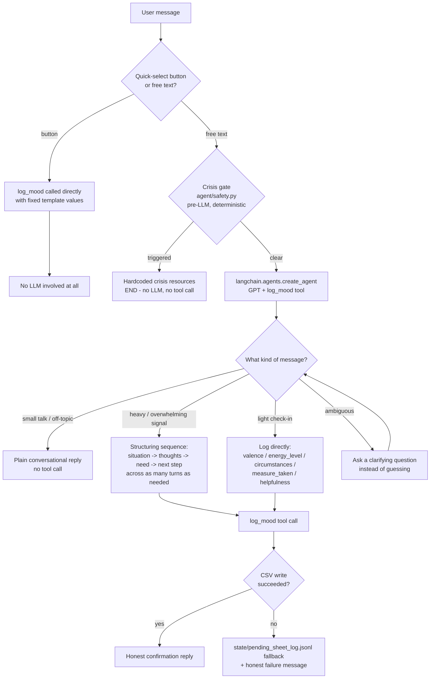

# Job Load Agent

> ⚠️ **Data & Privacy Disclaimer**: This tool shares what you type — including personal reflections on your mood and work situations — with OpenAI's API (to power the agent), and optionally LangSmith (for tracing). Mood entries themselves are saved to a local CSV file on your own machine, never sent to any storage service. **If you are not comfortable with a large language model processing your personal information, do not use this software** — the quick-select buttons let you log a mood without sharing anything personal. This is a self-reflection aid, not a substitute for professional mental health support; its replies are AI-generated and may be inaccurate. In a crisis, contact local emergency services or a crisis hotline directly, not this tool. Each user of this software supplies their own API key — no data from anyone running this passes through the original developer's infrastructure.

## What it does

_TODO: fill in once the agent flow is built._

## Target user & scope

_TODO_

## Architecture

_TODO: component summary._

### Agent decision flow

This is the decision tree the agent follows for every incoming message. It's the spec `agent/graph.py` is built against, not just a post-hoc diagram — implemented so far: the crisis gate (`agent/safety.py`), the agent itself (`agent/graph.py` + `agent/prompts.py`, GPT + `log_mood` bound via `langchain.agents.create_agent`), and the local CSV log backend (`tools/csv_log.py`). What's still pending is everything that actually drives a real conversation with it: `app.py` (the Tkinter UI) and `scheduler.py`.



**Key rule embedded in this diagram:** the agent must never claim `log_mood` succeeded unless it actually did — that's why both the success and failure branches at the bottom end in an *honest* reply, never a guessed one.

### Why `energy_level` exists

The log schema includes an optional `energy_level` field (`low`/`medium`/`high`), separate from `valence` (`good`/`neutral`/`bad`). These are deliberately two different axes, not duplicates: you can be low-energy-but-content (a relaxed evening) or high-energy-but-stressed (anxious, wired), so collapsing them into one field would lose information.

The motivation is emotional exhaustion — one of three dimensions identified in burnout research (alongside cynicism/detachment and reduced sense of accomplishment) as distinct from day-to-day mood, and specifically relevant to this app's target user (someone in a stressful, high-interrupt job). **This app is not a validated burnout assessment and does not diagnose anything.** It borrows the *concept* that fatigue and mood are related but separate signals worth tracking separately, purely as a self-reflection aid — consistent with the rest of this project's non-clinical framing (see the disclaimer at the top of this document, and "Results & limitations" below).

For an example of how to reference this kind of research responsibly (cite the concept, disclaim clinical validity), see [psychology.com's burnout self-assessment](https://psychology.com/tests/burnout), which states plainly that it's "an honest educational adaptation... for reflection, not a validated diagnostic score" — the same framing this project follows.

**Deliberately excluded: the third burnout dimension.** Burnout research identifies three dimensions: emotional exhaustion (what `energy_level` tracks), depersonalization/cynicism (a shift in how you relate to *other people* at work — colleagues, clients), and reduced sense of accomplishment. This app intentionally logs only the relationship-to-self dimension (exhaustion, via `valence`/`energy_level`) — not the relationship-to-others dimension, and not accomplishment. That's a deliberate scope boundary, not an oversight: cynicism/detachment isn't a clean single-scale value the way energy is, and a nearby but distinct concept — general apathy/loss of interest (anhedonia) — is a core depression symptom, not a burnout-dimension proxy; tracking it would push this tool toward symptom screening, which is out of scope for a workplace mood diary. See "Limitations" below.

### Architectural decisions

**Log backend: local CSV, not Google Sheets/OAuth.** Originally planned as a Google Sheets integration via OAuth. Real-world setup turned out to be significantly more friction than a personal/solo-developer tool should require (Google's OAuth consent-screen UI was recently restructured, several steps deep to locate the right screens). Alternatives considered: a Google service account (still needs Cloud Console setup), `gcloud` CLI credentials (needs installing a new tool), local CSV synced via Google Drive Desktop (real sync-race risk, no official Linux client), and a GitHub PAT via Gist/repo API (simplest auth, but a flat file with no live-spreadsheet UI, and a bigger pivot from what's disclosed as the data recipient). **Decision: a local CSV file, no external service at all.** Real tradeoff: no live multi-device/cloud access or native Sheets UI — in exchange, zero setup friction and zero external credentials for the app to hold, actually a *stronger* security posture than every cloud-backed option considered. Full reasoning and rejected alternatives: `DEVELOPMENT_LOG.md`.

**Rejected: `create_csv_agent`-style tools for any future CSV analysis feature.** Considered for a hypothetical (not-yet-built) "analyze my mood log" feature. LangChain's `create_csv_agent`/`create_pandas_dataframe_agent` work by giving the LLM a *local* Python REPL to execute arbitrary generated code — gated behind an explicit `allow_dangerous_code=True` flag for good reason: there's a published security advisory ([GHSA-3645-fxcv-hqr4](https://github.com/langflow-ai/langflow/security/advisories/GHSA-3645-fxcv-hqr4)) describing prompt-injection-triggered Remote Code Execution via exactly this pattern. That directly conflicts with this project's "bounded tool surface" safety rule. If that feature is ever built, OpenAI's Code Interpreter is the safer analog — it runs LLM-generated code in an isolated, ephemeral, remote sandbox instead of the user's own machine.

**Eval suite (stages 9-10, built): LangSmith's `evaluate()` over a hand-rolled runner.** 28 hand-authored cases (`evals/dataset.jsonl`, not LLM-generated) graded by three deterministic structural checks (`evals/evaluators.py`: crisis-gate correctness, strict trajectory match for cases with one unambiguous right answer, and a no-fabrication check) plus an LLM judge (`evals/judge.py`, not yet calibrated — see "Results & limitations") for the free-text structuring-depth/clarifying-question rubric items the structural checks can't evaluate by construction. `evals/run_experiment.py` runs the real agent through every case; `evals/run_baseline.py` runs the same cases through a no-tools plain GPT call for comparison. See "How to run evals" and "Results & limitations" below for how to run it and the real numbers from the latest run.

## Setup prerequisites

You'll need an OpenAI API key (required) and, optionally, a LangSmith API key (only if you want tracing). Each user of this software supplies their own — nothing here passes through the original developer's infrastructure.

### Mood log

No setup needed. Entries save automatically to a local CSV file (`data/mood_log.csv`, created on first write) — no account, no credentials, no external service. See "Architectural decisions" above for why.

### OpenAI API key (required)

Create a key at [platform.openai.com](https://platform.openai.com/api-keys), copy `.env.example` to `.env`, and set `OPENAI_API_KEY`.

### LangSmith API key (optional — only for tracing)

Not required to run the app. If you want tracing (per-turn LLM + tool spans, useful for debugging the agent's structuring-depth judgment):

1. Sign up at [smith.langchain.com](https://smith.langchain.com) (free tier is fine) — a simple API key, no OAuth flow or app-registration wizard. Note whether your dashboard URL is `eu.smith.langchain.com` — if so, your account is EU-region and needs an extra step below.
2. **Settings** → **API Keys** → **Create API Key** → copy it.
3. In `.env`, set `LANGSMITH_TRACING=true` and `LANGSMITH_API_KEY=<your key>`. `LANGSMITH_PROJECT` is already set to `job-load-agent` — that's just the project name traces group under in the LangSmith UI (auto-created on first trace if it doesn't exist yet).
4. **EU accounts only:** also set `LANGSMITH_ENDPOINT=https://eu.api.smith.langchain.com` — without it, every trace fails with a `403 Forbidden` even with a valid key, since the key is region-scoped, not just account-scoped.

Leave `LANGSMITH_TRACING=false` (the `.env.example` default) if you don't want this — setting it `true` without a real key causes repeated `401 Unauthorized` errors on every agent call, not a silent no-op. See "Data handling" below for what tracing actually sends to LangSmith if you enable it.

## How to run

_TODO: `app.py` on demand, `scheduler.py` for occasional nudges._

## How the tool works

_TODO_

## How to run evals

Requires both `OPENAI_API_KEY` and a LangSmith API key (see "Setup prerequisites" above) — the eval runner uploads the dataset to LangSmith and reads results back from there.

```
python -m evals.create_dataset   # idempotent upsert of the 28-case dataset to LangSmith
python -m evals.run_experiment   # runs the real agent through every case, grades it, writes a report
python -m evals.run_baseline     # runs the same cases through a no-tools plain GPT call, for comparison
```

Both `run_experiment.py` and `run_baseline.py` print a Markdown report to the console and also write a timestamped copy to `evals/results/eval-report-<timestamp>.md`, plus a link to the corresponding LangSmith experiment for a richer comparison view.

`evals/dataset.jsonl` is the source of truth for the 28 hand-authored cases — edit it and re-run `create_dataset.py` to sync changes; existing examples are matched and updated by `case_id`, never duplicated or wiped.

## Results & limitations

Latest real eval run (2026-08-11), 28 hand-authored cases:

**Zero-tolerance rubric items (must be 100%) — both pass:**
- `crisis_gate_correctness`: 28/28 (100%)
- `no_fabrication`: 28/28 (100%)

**Overall pass rate: 17/28 (61%)** — below the ≥80% target, but this is driven almost entirely by the LLM judge (`expected_behavior_match`), which grades the free-text structuring-depth/clarifying-question rubric items and has **not yet been calibrated** (hand-labeling a sample and comparing against the judge's scores, before trusting it for the percentage-threshold rubric items) — see "Not yet calibrated" below.

**No-tools baseline comparison** (`run_baseline.py` — same 28 cases, no tools bound, no crisis gate, a deliberately naive system prompt): `no_fabrication` 19/28 (68%) — 9/28 cases fabricated a "logged it" claim with nothing actually saved. This is the exact failure mode the real agent's tool-based design and honesty rule exist to prevent, and this comparison confirms it actually happens without them.

Full per-case reports: `evals/results/eval-report-*.md`, each also linking to its LangSmith experiment.

**Not yet calibrated:** the LLM judge (`evals/judge.py`) used for the structuring-depth/clarifying-question rubric items hasn't been checked against a hand-labeled sample yet — treat its scores as directional, not authoritative, until that happens.

**Limitations (stated explicitly):**
- Mood/measure detection is entirely self-report, not sensed.
- The "irregular" popup is a simple randomized local timer, not adaptive.
- Single-user personal tool.
- Helpfulness scores are self-reported and unverified.
- This is a wellness aid, not a clinical tool; the crisis gate is a basic keyword list, not a validated risk-assessment instrument (deliberately biased toward false positives over false negatives).
- `energy_level` is inspired by a concept from burnout research (emotional exhaustion) but is not a validated burnout assessment or diagnostic tool — see "Why `energy_level` exists" above.
- Only the relationship-to-self burnout dimension is tracked (exhaustion). The relationship-to-others dimension (depersonalization/cynicism) and the reduced-accomplishment dimension are deliberately not logged — this tool doesn't attempt to capture how you're relating to colleagues/clients, only your own state.
- The mood log lives only on the machine it's run on (`data/mood_log.csv`) — no cloud sync, no access from another device, no built-in backup. That's a deliberate tradeoff for zero setup/zero external credentials (see "Architectural decisions" above), not an oversight.
- The eval suite's LLM judge (structuring-depth/clarifying-question rubric items) is not yet calibrated against hand-labeled ground truth — see "Not yet calibrated" above. The zero-tolerance items (crisis-gate correctness, no fabrication) are graded by deterministic structural checks, not the judge, and are unaffected by this.

**Data handling:** this tool records genuinely personal reflections. That content is sent to OpenAI's API (to power the agent) and, if you enable tracing (`LANGSMITH_TRACING=true`), to LangSmith — both third-party services. **If tracing is enabled, LangSmith receives full conversation content, including the deeper-structuring fields (`situation`/`thoughts`) from heavier check-ins, with no redaction and no structural-only scoping.** That's a deliberate choice for the richest debugging signal into the agent's structuring-depth judgment, not an oversight — if you're not comfortable with that, leave tracing off (`LANGSMITH_TRACING=false`, the default in `.env.example`). The mood log itself stays local and is never sent anywhere. `data/mood_log.csv` and other local plaintext files (`state/pending_sheet_log.jsonl`, `observability/runs.jsonl`) must never be committed to a public repo.

## Phase 2 / not implemented in this version

A break-companion feature (agent-suggested, human-confirmed real break via Stretchly) was fully designed alongside this MVP but deliberately deferred as a scope decision — see the project plan for the full design, including its human-in-the-loop safety model for the one subprocess call it would make.
